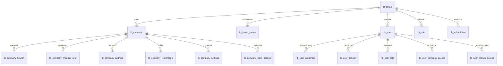
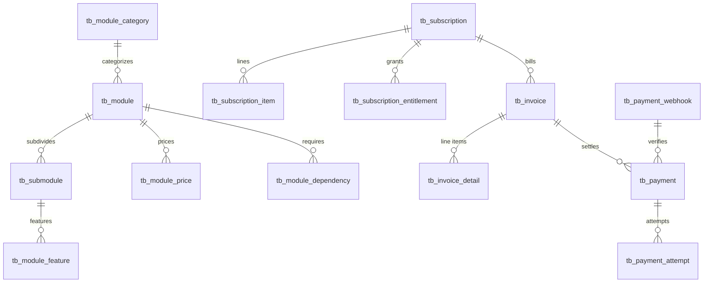
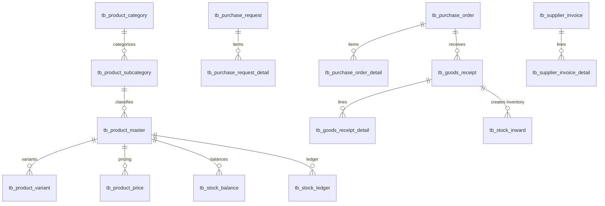
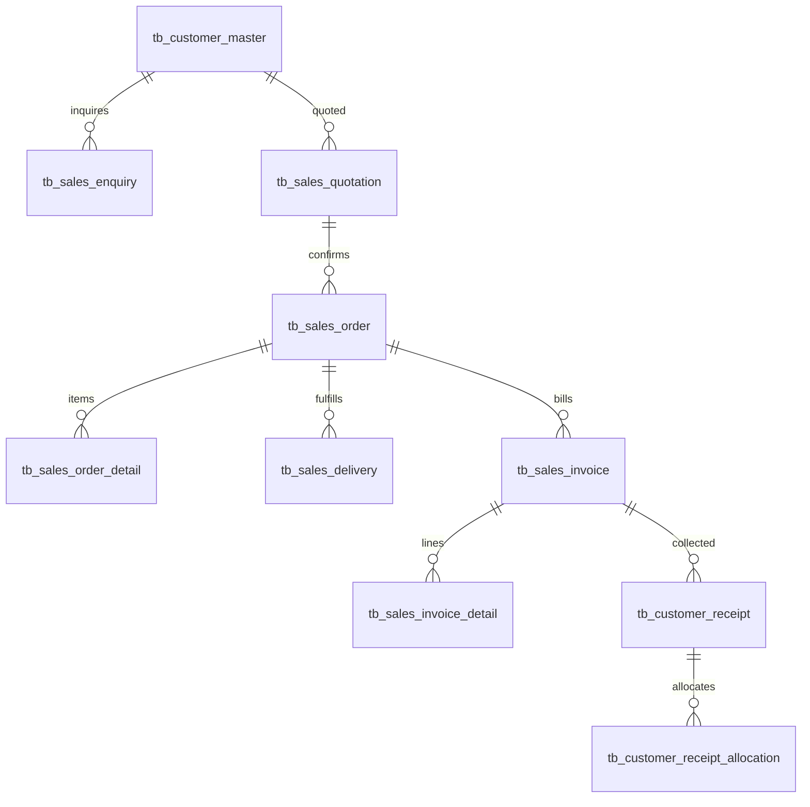
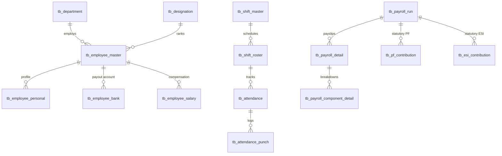
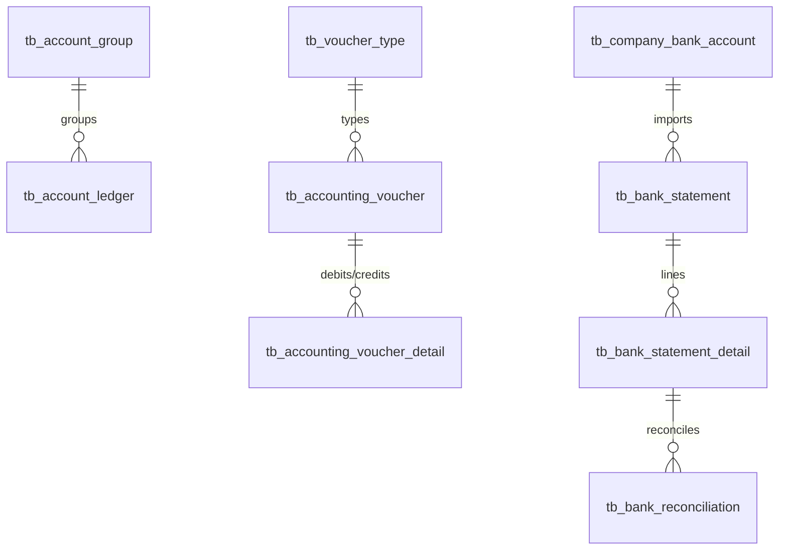

# ZUNO ERP — Database Relationship Architecture & ERD

## 1. Multi-Tenant Core & Organization Boundary

## 2. SaaS Entitlement & Subscription Lifecycle

## 3. Product, Inventory & Supply Chain Flow

## 4. Sales, Invoicing & Delivery Workflow

## 5. HR, Attendance & Payroll Lifecycle

## 6. General Ledger & Double-Entry Accounting

